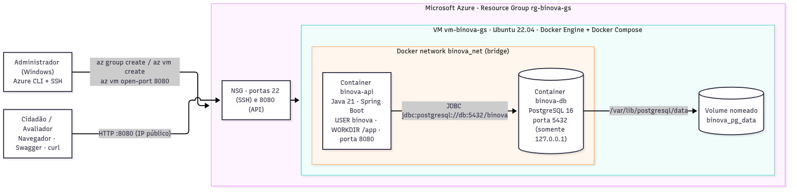
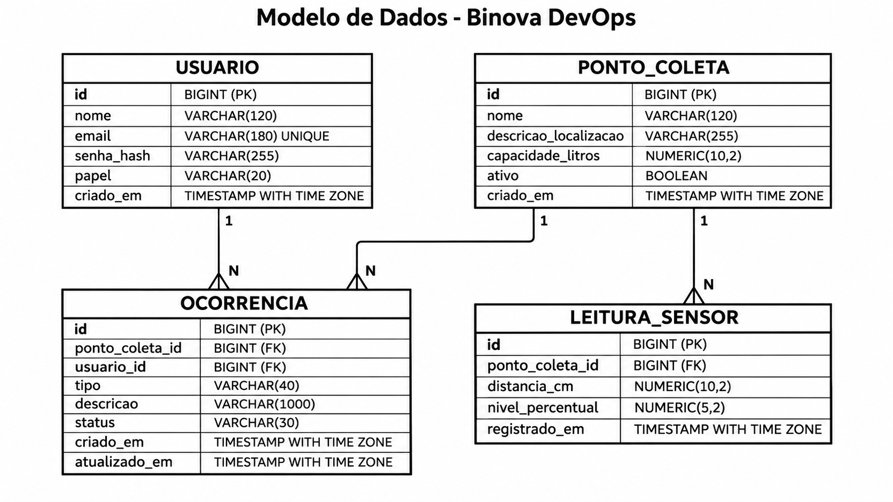

# Binova ♻️ | DevOps Tools & Cloud Computing

**FIAP · Global Solution 2026/2 · CitizenTech**  
**Turma:** 2TDSPS  
**Repositório:** https://github.com/viniciusmorrone/Binova_Devops_gs  
**Vídeo demonstrativo:** https://youtu.be/c9xTSJElE-k

## Equipe

| Integrante | RM |
|---|---|
| Gustavo de Jesus | 567926 |
| Gustavo Siciliano | 568419 |
| Samuel Keniti | 567614 |
| Manuel Pedro | 567458 |
| Vinicius Morrone | 566884 |

## 1. Sobre o projeto

O **Binova** é uma solução CitizenTech para acompanhar pontos de coleta de resíduos, registrar leituras de sensores e permitir o cadastro de ocorrências, como lixeiras cheias ou descarte irregular. As informações ajudam a organizar o acompanhamento e o atendimento dos pontos monitorados. A proposta se relaciona aos **ODS 11 (Cidades e Comunidades Sustentáveis)** e **12 (Consumo e Produção Responsáveis)**.

Nesta entrega de DevOps, uma **API Java 21 / Spring Boot** e um **banco PostgreSQL 16** executam em containers Docker integrados por Docker Compose, em uma **máquina virtual Ubuntu 22.04 no Microsoft Azure**. O provisionamento e a publicação são automatizados por `deploy-azure.sh` e executados pela Azure CLI no Cloud Shell (Bash).

**Vídeo da demonstração:** [Binova — DevOps, Azure, Docker e PostgreSQL](https://youtu.be/c9xTSJElE-k).

## 2. Arquitetura



| Componente | Configuração |
|---|---|
| Nuvem | Microsoft Azure |
| Resource Group | `rg-binova-gs` |
| Máquina virtual | `vm-binova-gs` · Ubuntu 22.04 · `Standard_D2s_v4` · região `brazilsouth` |
| Administração | Azure CLI e SSH, usuário `azureuser` |
| Aplicação | `binova-api` · Spring Boot / Java 21 · imagem `binova-api:1.0` |
| Banco | `binova-db` · `postgres:16-alpine` |
| Rede Docker | `binova_net` (bridge) |
| Volume persistente | `binova_pg_data`, montado em `/var/lib/postgresql/data` |
| API | Porta `8080`, exposta no IP público da VM |
| PostgreSQL | Porta `5432`, publicada apenas em `127.0.0.1` da VM |
| SSH | Porta `22` |

Fluxo: **cliente → IP público Azure:8080 → container da API → rede Docker `binova_net` → PostgreSQL**, cujos dados ficam armazenados no volume nomeado.

O `Dockerfile` possui **build multi-stage**: Maven/JDK 21 na compilação e JRE 21 na execução, `WORKDIR /app`, `USER binova` (não root), variáveis `ENV` e `EXPOSE 8080`. O `docker-compose.yml` define `app` e `db`, rede, volume, portas, variáveis de ambiente e `depends_on` condicionado ao healthcheck do PostgreSQL (`pg_isready`).

### Modelo de dados



As tabelas da API no PostgreSQL incluem `usuario`, `ponto_coleta`, `leitura_sensor` e `ocorrencia`. Os relacionamentos incluem `leitura_sensor.ponto_coleta_id → ponto_coleta.id`, `ocorrencia.ponto_coleta_id → ponto_coleta.id` e `ocorrencia.usuario_id → usuario.id`.

**Importante:** o PostgreSQL em container pertence à demonstração de DevOps e não substitui as configurações de banco exigidas em outras disciplinas.

## 3. Organização do repositório

```text
Binova_Devops_gs/
├── README.md
├── deploy-azure.sh          # provisionamento e deploy automatizado
├── Dockerfile               # build e runtime da API Java
├── docker-compose.yml       # aplicação, banco, rede e volume
├── .env.example             # modelo das variáveis (não contém segredos reais)
├── .dockerignore
├── .gitignore
├── app/                     # projeto Spring Boot (pom.xml e src/)
├── scripts/
│   ├── instalar-docker.sh
│   └── testar-crud.sh
├── docs/
│   ├── arquitetura.png
│   └── Diagrama.png
└── evidencias/              # registros visuais da execução
```

## 4. Requisitos

- Assinatura Microsoft Azure ativa, com créditos e permissão para criar VM, IP e recursos de rede.
- **Azure Cloud Shell em modo Bash**, aberto pelo Portal Azure (a CLI `az`, SSH e Git já ficam disponíveis no Cloud Shell).
- Acesso à internet para clonar o repositório e baixar as imagens Docker.
- Região e tamanho de VM autorizados pela assinatura. O ambiente documentado foi executado em **`brazilsouth` / `Standard_D2s_v4`**, mas a disponibilidade pode mudar.
- Para os testes CRUD no Cloud Shell, `curl` e `python3` disponíveis.

Os comandos seguintes estão organizados conforme o terminal utilizado. **Não execute comandos do Cloud Shell dentro da VM nem comandos `sudo docker` fora dela.**

## 5. Execução completa — passo a passo

### Passo 1 — Clonar o repositório (Azure Cloud Shell / Bash)

```bash
cd ~
git clone https://github.com/viniciusmorrone/Binova_Devops_gs.git
cd ~/Binova_Devops_gs
```

Se a pasta já existir e você quiser **manter** os arquivos locais, atualize em vez de clonar:

```bash
cd ~/Binova_Devops_gs
git pull --ff-only origin main
```

A remoção completa do clone **local** é uma opção apenas quando você não precisa das alterações que estão nele:

```bash
cd ~
rm -rf ~/Binova_Devops_gs
git clone https://github.com/viniciusmorrone/Binova_Devops_gs.git
cd ~/Binova_Devops_gs
```

`rm -rf` remove permanentemente os arquivos da pasta local; não altera o GitHub nem os recursos Azure.

### Passo 2 — Provisionar e publicar a API (Azure Cloud Shell / Bash)

```bash
bash deploy-azure.sh
```

Quando solicitado, digite **`CRIAR`**. O script:

1. Confere a sessão Azure e cria ou reutiliza o Resource Group `rg-binova-gs`.
2. Cria ou inicia a VM `vm-binova-gs` com Ubuntu 22.04, em `brazilsouth`, tamanho `Standard_D2s_v4`.
3. Configura acesso SSH (`22`) e HTTP da API (`8080`) no NSG.
4. Usa `az vm run-command invoke` para configurar a VM sem exigir SSH na instalação.
5. Instala Docker e Docker Compose quando necessário.
6. Clona o projeto em **`/opt/binova`**, ou faz `git pull --ff-only` se o clone existente não tiver modificações locais.
7. Cria o `.env` a partir do `.env.example` quando ainda não existe; gera senha do PostgreSQL e segredo JWT, preservando o `.env` em novas execuções.
8. Valida o Compose, executa `docker compose up -d --build` e aguarda uma resposta do endpoint de saúde.
9. Imprime as URLs da API e do Swagger e o comando SSH.

O script não exibe todos os logs da compilação por padrão. A ausência de mensagens de progresso não indica falha: aguarde o retorno do terminal. A confirmação de conclusão consiste nas URLs finais; em caso de falha, consulte a seção **9. Solução de problemas**.

**Não é necessário executar manualmente `az vm create`, `git clone`, instalação do Docker, criação do `.env` ou `docker compose up` na VM após o sucesso desse script.** Esses passos já são executados automaticamente.

### Passo 3 — Mostrar a infraestrutura e descobrir o IP (Azure Cloud Shell)

```bash
az vm show -d -g rg-binova-gs -n vm-binova-gs -o table
az resource list -g rg-binova-gs -o table
az network nsg rule list -g rg-binova-gs --nsg-name vm-binova-gsNSG -o table
IP=$(az vm show -d -g rg-binova-gs -n vm-binova-gs --query publicIps -o tsv)
echo "$IP"
```

**O IP público é dinâmico e pode mudar após a recriação da VM.** Não reutilize o endereço mostrado em um vídeo antigo como se fosse um endereço permanente.

### Passo 4 — Conectar via SSH (Azure Cloud Shell → VM)

```bash
ssh azureuser@"$IP"
```

Na primeira conexão, confirme a fingerprint **somente se for a VM que você acabou de provisionar**. Em seguida, os comandos serão executados **dentro da VM**, com prompt semelhante a `azureuser@vm-binova-gs:~$`:

```bash
whoami
hostname
docker --version
docker compose version
cd /opt/binova
ls -la
```

### Passo 5 — Examinar a aplicação e o Compose (dentro da VM)

```bash
cat Dockerfile
cat docker-compose.yml
sudo docker compose ps
sudo docker images
```

Não imprima o conteúdo de `.env` durante a gravação, pois ele contém credenciais e o segredo JWT.

### Passo 6 — Logs e acesso aos containers (dentro da VM)

```bash
sudo docker compose logs --tail=30 app
sudo docker compose logs --tail=30 db
sudo docker compose exec app sh -c 'id && pwd && ls -la'
sudo docker compose exec db sh -c 'id && pwd'
```

O `id` do serviço `app` deve mostrar o usuário não privilegiado definido no Dockerfile; o `pwd` deve mostrar `/app`. A saída real dos logs depende do estado do ambiente.

### Passo 7 — Mostrar as tabelas e executar SELECT / JOIN (dentro da VM)

```bash
sudo docker compose exec db sh -c 'psql -U "$POSTGRES_USER" -d "$POSTGRES_DB" -c "\dt"'
```

```bash
sudo docker compose exec db sh -c 'psql -U "$POSTGRES_USER" -d "$POSTGRES_DB" -c "SELECT * FROM ponto_coleta;"'
```

```bash
sudo docker compose exec db sh -c 'psql -U "$POSTGRES_USER" -d "$POSTGRES_DB" -c "SELECT * FROM leitura_sensor;"'
```

```bash
sudo docker compose exec db sh -c 'psql -U "$POSTGRES_USER" -d "$POSTGRES_DB" -c "SELECT p.id, p.nome, l.distancia_cm, l.nivel_percentual FROM ponto_coleta p JOIN leitura_sensor l ON l.ponto_coleta_id = p.id ORDER BY l.id;"'
```

```bash
sudo docker compose exec db sh -c 'psql -U "$POSTGRES_USER" -d "$POSTGRES_DB" -c "SELECT * FROM ocorrencia;"'
```

**`(0 rows)` não é um erro SQL.** Significa que a consulta foi executada, mas ainda não há dados correspondentes. Para demonstrar os relacionamentos com registros reais, execute o CRUD do próximo passo e repita as consultas. O script de CRUD mantém o ponto de coleta e a leitura cadastrados para o SELECT e o JOIN, mas exclui a ocorrência utilizada no teste de DELETE.

### Passo 8 — Executar o CRUD da API (Azure Cloud Shell)

Saia apenas da sessão SSH (isso **não** desliga a VM, não remove containers e não apaga dados):

```bash
exit
```

De volta ao Cloud Shell, entre na pasta local e obtenha novamente o IP público:

```bash
cd ~/Binova_Devops_gs
IP=$(az vm show -d -g rg-binova-gs -n vm-binova-gs --query publicIps -o tsv)
curl -i "http://$IP:8080/actuator/health"
bash scripts/testar-crud.sh "http://$IP:8080"
```

O script `scripts/testar-crud.sh` executa, em ordem:

1. Login do administrador por JWT (`POST /api/auth/login`).
2. **CREATE:** criação de ponto de coleta (`POST /api/pontos-coleta`).
3. **READ:** consulta do ponto criado (`GET /api/pontos-coleta/{id}`).
4. **UPDATE:** atualização do ponto (`PUT /api/pontos-coleta/{id}`).
5. Cadastro de uma leitura vinculada ao ponto (`POST /api/pontos-coleta/{id}/leituras`).
6. Cadastro de ocorrência vinculada ao ponto (`POST /api/ocorrencias`).
7. Consulta e atualização da ocorrência (`GET` e `PUT /api/ocorrencias/{id}`).
8. **DELETE:** remoção física da ocorrência (`DELETE /api/ocorrencias/{id}`) e verificação de `404` após excluir.
9. Preservação do ponto cadastrado para demonstração de SELECT e JOIN no banco.

A senha de administrador utilizada pelo script é definida pela variável `APP_DEMO_ADMIN_PASSWORD`, com valor padrão de demonstração `AdminLocal2026` no `.env.example`. **Não use essas credenciais em produção.** Caso tenha alterado a senha na VM, informe a mesma senha no ambiente em que executa `testar-crud.sh` (sem publicar o valor):

```bash
read -rs -p "Senha do admin: " APP_DEMO_ADMIN_PASSWORD; echo
export APP_DEMO_ADMIN_PASSWORD
bash scripts/testar-crud.sh "http://$IP:8080"
unset APP_DEMO_ADMIN_PASSWORD
```

O script utiliza `curl`, `python3` e acesso HTTP à API. O resultado esperado é uma confirmação final de que os testes foram concluídos. Um ponto permanece cadastrado para a demonstração de persistência.

Para exibir a URL do Swagger:

```bash
printf 'Swagger: http://%s:8080/swagger-ui.html\n' "$IP"
```

Abra a URL no navegador, se a VM estiver ligada e a API estiver respondendo. Para operar rotas protegidas, é necessário autenticar-se e informar o token JWT.

### Passo 9 — Demonstrar persistência pelo volume (VM)

Retorne à VM e abra o diretório do projeto:

```bash
ssh azureuser@"$IP"
cd /opt/binova
```

**Antes de reiniciar os containers**, consulte os registros preservados pelo teste CRUD:

```bash
sudo docker volume ls --filter name=binova_pg_data
sudo docker compose exec db sh -c 'psql -U "$POSTGRES_USER" -d "$POSTGRES_DB" -c "SELECT id, nome, ativo FROM ponto_coleta ORDER BY id;"'
```

Anote o ID e o nome de um ponto presente na resposta. Depois, recrie os containers mantendo o volume:

```bash
sudo docker compose down
sudo docker compose up -d
sudo docker compose ps
```

Agora repita a consulta:

```bash
sudo docker compose exec db sh -c 'psql -U "$POSTGRES_USER" -d "$POSTGRES_DB" -c "SELECT id, nome, ativo FROM ponto_coleta ORDER BY id;"'
```

**A persistência é demonstrada quando o mesmo registro aparece antes e depois de recriar os containers.** Se as consultas estiverem vazias, ainda não há evidência de persistência de registros. **Não utilize `docker compose down -v`**, porque a opção `-v` remove os volumes gerenciados pelo Compose e pode apagar os dados do PostgreSQL.

### Passo 10 — Conferir a API pública (Cloud Shell)

```bash
exit
curl -i "http://$IP:8080/actuator/health"
az vm show -d -g rg-binova-gs -n vm-binova-gs -o table
```

O endpoint pode retornar `HTTP 200` e `status: UP`, indicando que as verificações de saúde configuradas foram atendidas. Isso não substitui os testes de CRUD e de persistência.

## 6. Execução manual do Docker (alternativa, se a VM já estiver preparada)

O fluxo recomendado é o **`deploy-azure.sh`**, mas, se a VM e o repositório já estiverem preparados, os containers podem ser administrados diretamente na VM:

```bash
cd /opt/binova
sudo docker compose config --quiet
sudo docker compose up -d --build
sudo docker compose ps
sudo docker compose logs --tail=50 app
sudo docker compose logs --tail=50 db
```

O script `scripts/instalar-docker.sh` existe para instalação manual, mas não precisa ser executado separadamente quando o deploy automatizado já instalou o Docker. Ao executar `docker compose` na VM com usuário `azureuser`, os exemplos usam `sudo`; no Run Command do Azure, o script é executado com permissões administrativas.

## 7. Evidências da disciplina

O repositório inclui evidências em `evidencias/`. Os registros devem corresponder às execuções efetivamente realizadas, mesmo que o IP público varie entre demonstrações.

| Evidência | Arquivo |
|---|---|
| Azure CLI, grupo e VM | [`01-azure-cli.png`](evidencias/01-azure-cli.png) |
| SSH e versões do Docker | [`02-vm-docker.png`](evidencias/02-vm-docker.png) |
| Estrutura do projeto na VM | [`03-estrutura.png`](evidencias/03-estrutura.png) |
| Containers em background | [`04-compose-ps.png`](evidencias/04-compose-ps.png) |
| Logs da aplicação e banco | [`05-logs.png`](evidencias/05-logs.png) |
| Usuário não-root e WORKDIR | [`06-exec-usuario.png`](evidencias/06-exec-usuario.png) |
| CRUD via API pública | [`07-crud.png`](evidencias/07-crud.png) |
| SELECT e JOIN no PostgreSQL | [`08-select-join.png`](evidencias/08-select-join.png) |
| Volume e persistência | [`09-persistencia.png`](evidencias/09-persistencia.png) |
| Healthcheck público | [`10-acesso-publico.png`](evidencias/10-acesso-publico.png) |

Para demonstrar o funcionamento, assista ao **[vídeo do Binova no YouTube](https://youtu.be/c9xTSJElE-k)**.

## 8. Comandos de diagnóstico

Os seguintes comandos são úteis quando algum passo não funciona. Rode-os no terminal indicado.

**Cloud Shell — conta, VM e IP:**

```bash
az account show --query '{assinatura:name,id:id,estado:state}' -o table
az group exists -n rg-binova-gs
az vm show -d -g rg-binova-gs -n vm-binova-gs -o table
az network nsg rule list -g rg-binova-gs --nsg-name vm-binova-gsNSG -o table
```

**VM — containers, logs, saúde e configuração:**

```bash
cd /opt/binova
sudo docker compose ps
sudo docker compose logs --tail=100 app
sudo docker compose logs --tail=100 db
sudo docker compose config --quiet
curl -i http://127.0.0.1:8080/actuator/health
```

## 9. Solução de problemas

### 9.1 `fatal: destination path 'Binova_Devops_gs' already exists`

O clone local já existe. Prefira reutilizar e atualizar:

```bash
cd ~/Binova_Devops_gs
git pull --ff-only origin main
```

Se precisar reconstruir o clone local do zero e **não houver alterações locais a preservar**:

```bash
cd ~
rm -rf ~/Binova_Devops_gs
git clone https://github.com/viniciusmorrone/Binova_Devops_gs.git
```

A exclusão local não modifica o repositório remoto.

### 9.2 O script continua usando a região ou VM antiga

Confirme se o `deploy-azure.sh` local foi atualizado:

```bash
cd ~/Binova_Devops_gs
git pull --ff-only origin main
grep -E '^LOCATION=|^VM_SIZE=' deploy-azure.sh
```

Os valores documentados e usados na versão atual são `brazilsouth` e `Standard_D2s_v4`. A versão antiga do README mencionava `northcentralus` e um tamanho da família B, que **não** correspondem ao deploy utilizado nesta demonstração.

### 9.3 Erro `ResourceNotFound`: `vm-binova-gs` não encontrada

Normalmente o grupo existe, mas a VM ainda não foi criada, foi excluída ou o deploy foi interrompido. Verifique:

```bash
az group exists -n rg-binova-gs
az vm list -g rg-binova-gs -o table
```

Se a VM não existir e você desejar criá-la, execute **no Cloud Shell, dentro do repositório**:

```bash
cd ~/Binova_Devops_gs
bash deploy-azure.sh
```

O script cria ou reaproveita recursos, conforme seu estado. Confira a assinatura Azure ativa se não encontrar recursos que esperava existir.

### 9.4 Região bloqueada por política Azure

O erro pode citar `RequestDisallowedByPolicy` ou `Allowed resource deployment regions`. Confirme as restrições da assinatura:

```bash
az policy assignment list --query '[].{nome:displayName,parametros:parameters}' -o json
```

Utilize uma região permitida. **O ambiente da demonstração foi criado em `brazilsouth`;** isso não garante que todas as assinaturas permitam a mesma região.

### 9.5 Tamanho da VM indisponível (`SkuNotAvailable`, cota ou capacidade)

```bash
az vm list-skus --location brazilsouth --resource-type virtualMachines -o table
az vm list-usage --location brazilsouth -o table
```

A disponibilidade pode variar por assinatura, região, zona e momento. Se for necessário alterar o tamanho, use um SKU autorizado e adequado à aplicação; no deploy Bash, é possível passar um tamanho alternativo por variável, por exemplo `VM_SIZE=SKU_AUTORIZADO bash deploy-azure.sh`.

### 9.6 Falha na conexão SSH (`Permission denied`, timeout ou host key)

Primeiro, obtenha o IP atual e o estado da VM:

```bash
IP=$(az vm show -d -g rg-binova-gs -n vm-binova-gs --query publicIps -o tsv)
echo "$IP"
ssh azureuser@"$IP"
```

- `Permission denied (publickey)`: confira o usuário e a chave SSH utilizada. A opção `--generate-ssh-keys` cria ou usa chaves no ambiente onde o `az vm create` foi executado; trocar ou redefinir o Cloud Shell pode exigir recuperar a chave ou redefinir o acesso SSH no Azure.
- Timeout: confira se a VM está em execução e se a regra de entrada para a porta 22 está ativa no NSG.
- Aviso de fingerprint modificada: não ignore automaticamente. Verifique se a VM foi recriada e se o IP pertence à VM esperada antes de atualizar `known_hosts`.
- A confirmação `yes` na primeira conexão apenas registra a chave do host; não altera o Docker nem o banco.

### 9.7 `docker: permission denied` ou acesso ao daemon recusado

Dentro da VM, utilize `sudo`:

```bash
cd /opt/binova
sudo docker compose ps
```

Se o daemon não estiver ativo:

```bash
sudo systemctl status docker
sudo systemctl start docker
```

### 9.8 API inacessível, `curl: (7) Failed to connect` ou Swagger não abre

Confirme containers e logs dentro da VM:

```bash
cd /opt/binova
sudo docker compose ps
sudo docker compose logs --tail=100 app
sudo docker compose logs --tail=100 db
curl -i http://127.0.0.1:8080/actuator/health
```

Se a API funciona localmente mas não externamente, revise o IP público atual e a regra do NSG para a porta 8080. Se a API falha também localmente, examine os logs da aplicação e a saúde do banco; não abra a porta 5432 para a internet como solução.

### 9.9 Containers não inicializam ou `docker compose` falha

```bash
cd /opt/binova
sudo docker compose config --quiet
sudo docker compose ps
sudo docker compose logs --tail=100 db
sudo docker compose logs --tail=100 app
```

A configuração pode falhar por variáveis ausentes no `.env`, erro no build, falta de espaço, problemas na imagem ou indisponibilidade do banco. Confirme o erro real antes de alterar os arquivos. Evite publicar `.env` ou imprimir valores de segredos.

### 9.10 `SELECT ... (0 rows)` no PostgreSQL

Isso indica tabela vazia, **não erro da consulta**. Execute o CRUD, que cadastra ponto e leitura, e depois repita o SELECT e o JOIN. Note que a ocorrência do teste é excluída propositalmente; é normal que a tabela `ocorrencia` fique vazia após esse teste.

### 9.11 Teste CRUD falha no login JWT (`401`, `403` ou token ausente)

Confirme se a URL da API está correta, se a aplicação está respondendo e se a senha de demonstração do script corresponde à configurada na VM. A conta de teste usa `admin@binova.local`, mas a senha pode ter sido modificada. Veja a alternativa interativa de senha no **Passo 8**; não registre senhas reais em vídeo, prints ou commits.

### 9.12 Repositório da VM não atualiza / arquivos antigos continuam

O deploy faz `git pull --ff-only` em `/opt/binova` somente quando o clone remoto local não contém alterações não versionadas. Verifique na VM:

```bash
cd /opt/binova
git status --short
git remote -v
```

Se houver alterações locais, preserve-as ou faça uma revisão antes de atualizar. **Não execute `git reset --hard` automaticamente**, pois ele descarta mudanças locais. Se o objetivo é somente atualizar o README no GitHub, faça o commit e o push no repositório correspondente antes de repetir o deploy.

### 9.13 Falha no healthcheck / deploy termina com erro

O script aguarda o endpoint local `http://127.0.0.1:8080/actuator/health` por uma janela limitada. Se a compilação ou inicialização demorar, a execução pode não passar no teste, mesmo com recursos criados. Acesse a VM, consulte os logs e a saída de `docker compose ps`; se for apenas demora de inicialização, execute novamente após identificar o estado real. Não assuma que um deploy parcial deixou todos os componentes saudáveis.

## 10. Segurança e observações

- O ambiente é **acadêmico e demonstrativo**, não uma implantação pronta para produção.
- O Swagger e a API são publicados pela porta 8080 em HTTP; para produção, prefira HTTPS, autenticação e regras de rede restritas.
- O `.env.example` contém credenciais de demonstração conhecidas. Altere-as fora do laboratório e não publique `.env`, segredos ou tokens.
- O banco não é exposto publicamente pelo Compose: `5432` fica associado ao loopback da VM.
- O `deploy-azure.sh` pode criar recursos que consomem créditos Azure. A VM não é desligada automaticamente depois do deploy.
- **Reiniciar/recriar containers** não equivale a **recriar a VM ou excluir o Resource Group**: excluir a VM e seus discos pode remover também os volumes do Docker hospedados nela.

## 11. Pausar, retomar e excluir a infraestrutura (Cloud Shell)

### Desalocar a VM após a gravação

```bash
az vm deallocate -g rg-binova-gs -n vm-binova-gs
```

Desalocar interrompe a cobrança de computação da VM, mas **discos e outros recursos podem continuar gerando custos**. Para retomar:

```bash
az vm start -g rg-binova-gs -n vm-binova-gs
```

Depois, atualize o IP com o comando do Passo 3.

### Excluir o projeto da Azure após concluir tudo

**Atenção: operação destrutiva.** Só execute depois de finalizar vídeo, prints, entrega e qualquer apresentação que precise do ambiente; a exclusão remove VM, discos, rede, IP e dados associados ao grupo `rg-binova-gs`.

```bash
az group delete --name rg-binova-gs --yes --no-wait
az group wait --deleted --name rg-binova-gs --interval 10 --timeout 600
```

### Verificação final da exclusão

```bash
if [ "$(az group exists --name rg-binova-gs)" = "false" ]; then
  echo 'OK: Resource Group rg-binova-gs excluido.'
else
  echo 'ATENCAO: Resource Group rg-binova-gs ainda existe.'
fi
```

A verificação confirma a remoção do grupo na assinatura ativa; **não** comprova a remoção de eventuais recursos criados em outros grupos ou assinaturas. Os arquivos do repositório no GitHub e no Cloud Shell são independentes da exclusão do Resource Group.