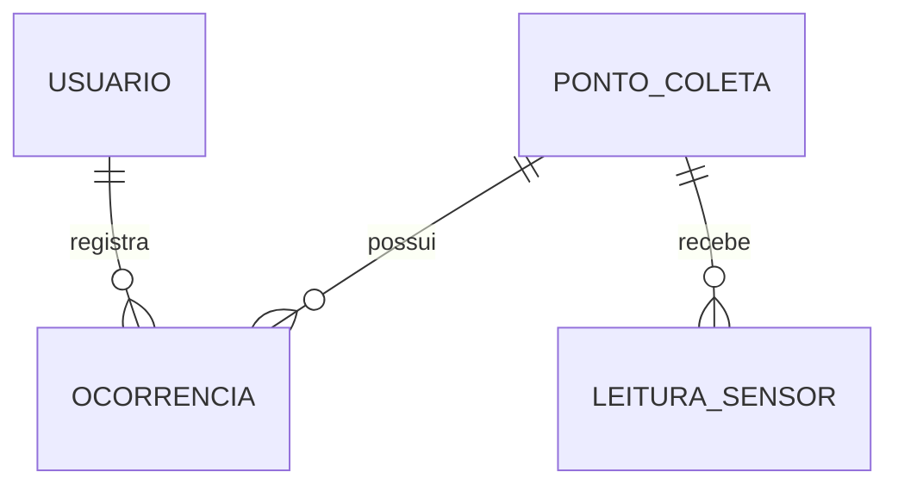

# Binova ♻️ — DevOps Tools & Cloud Computing

**FIAP · Global Solution 2026/2 · CitizenTech**
**Turma:** 2TDSPS
**Solução:** Binova — monitoramento inteligente de lixeiras e participação cidadã

| Integrante | RM |
|---|---|
| Gustavo de Jesus | 567926 |
| Gustavo Siciliano | 568419 |
| Samuel Keniti | 567614 |
| Manuel Pedro | 567458 |
| Vinicius Morrone | 566884 |

**Vídeo (YouTube, não listado):** COLOCAR_LINK_DO_VIDEO

## 1. Sobre a solução

O **Binova** ajuda comunidades a acompanhar lixeiras de uso coletivo: a API recebe leituras de sensores de enchimento, cadastra pontos de coleta e permite que cidadãos registrem ocorrências (lixeira cheia, descarte irregular, estrutura danificada). Tema **CitizenTech**: tecnologia com o cidadão no centro, alinhada aos ODS 9, 11 e 12.

Nesta disciplina, a **API Java (Spring Boot)** desenvolvida em Java Advanced e o **banco PostgreSQL** executam em **dois containers integrados por Docker Compose**, dentro de uma **VM Linux no Microsoft Azure provisionada via Azure CLI**.

## 2. Arquitetura macro


```mermaid
flowchart LR
    DEV["Administrador (Windows)<br/>Azure CLI + SSH"] -->|"az group create / az vm create<br/>az vm open-port 8080"| AZ
    USR["Cidadão / Avaliador<br/>Navegador · Swagger · curl"] -->|"HTTP :8080 (IP público)"| NSG

    subgraph AZ["Microsoft Azure · Resource Group rg-binova-gs"]
        NSG["NSG · portas 22 (SSH) e 8080 (API)"] --> VM
        subgraph VM["VM vm-binova-gs · Ubuntu 22.04 · Docker Engine + Docker Compose"]
            subgraph NET["Docker network binova_net (bridge)"]
                APP["Container binova-api<br/>Java 21 · Spring Boot<br/>USER binova · WORKDIR /app · porta 8080"]
                DB[("Container binova-db<br/>PostgreSQL 16<br/>porta 5432 (somente 127.0.0.1)")]
            end
            VOL[("Volume nomeado<br/>binova_pg_data")]
        end
    end

    APP -->|"JDBC jdbc:postgresql://db:5432/binova"| DB
    DB -->|"/var/lib/postgresql/data"| VOL
```

| Componente | Detalhe |
|---|---|
| Nuvem | Microsoft Azure · Resource Group `rg-binova-gs` · VM `vm-binova-gs` (Ubuntu 22.04) |
| Provisionamento | Azure CLI (`az group create`, `az vm create`, `az vm open-port`) |
| Container da aplicação | `binova-api` · imagem `binova-api:1.0` construída pelo `Dockerfile` (multi-stage, Java 21) |
| Container do banco | `binova-db` · imagem `postgres:16-alpine` |
| Rede | `binova_net` (bridge) — a API acessa o banco pelo nome do serviço `db` |
| Persistência | Volume nomeado `binova_pg_data` montado em `/var/lib/postgresql/data` |
| Portas | `8080` (API, liberada no NSG) · `5432` (banco, publicada apenas em `127.0.0.1` da VM) |

## 3. Modelo de dados (tabelas relacionadas)



As tabelas `usuario`, `ponto_coleta`, `leitura_sensor` e `ocorrencia` são criadas pelo Hibernate no PostgreSQL, com chaves estrangeiras `leitura_sensor.ponto_coleta_id → ponto_coleta.id` e `ocorrencia.ponto_coleta_id → ponto_coleta.id` / `ocorrencia.usuario_id → usuario.id`.

## 4. Estrutura do repositório

```text
Binova_Devops_gs/
├── README.md                 # este How To
├── Dockerfile                # build Maven + runtime Java 21 com usuário não-root
├── docker-compose.yml        # app + banco + network + volume + portas + env + depends_on
├── .env.example              # modelo das variáveis de ambiente (sem senhas reais)
├── .dockerignore
├── .gitignore
├── app/                      # código-fonte da API Java (Spring Boot) do Binova
│   ├── pom.xml
│   └── src/
├── scripts/
│   ├── instalar-docker.sh    # instala Docker Engine + Compose na VM
│   └── testar-crud.sh        # demonstra o CRUD via HTTP
├── docs/
│   ├── arquitetura.mmd       # fonte do diagrama
│   └── arquitetura.png       # arquitetura macro
└── evidencias/               # prints da execução na VM Azure
```

## 5. Requisitos da disciplina × implementação

| Requisito | Onde está |
|---|---|
| VM Azure via Azure CLI | Seção 6.2 (comandos documentados) |
| Docker + Compose na VM | `scripts/instalar-docker.sh` · seção 6.4 |
| App Java em container | `Dockerfile` · serviço `app` |
| Usuário não privilegiado | `USER binova` no `Dockerfile` |
| WORKDIR | `WORKDIR /app` no `Dockerfile` |
| Variáveis de ambiente | `ENV` no `Dockerfile` · `environment` no Compose · `.env` |
| Porta exposta | `EXPOSE 8080` · `ports: "8080:8080"` |
| Banco em container | serviço `db` (`postgres:16-alpine`) |
| Volume nomeado | `binova_pg_data` |
| Network | `binova_net` |
| Dependência entre serviços | `depends_on` com `condition: service_healthy` (healthcheck `pg_isready`) |
| CRUD completo + 2 tabelas relacionadas | `/api/pontos-coleta`, `/api/pontos-coleta/{id}/leituras`, `/api/ocorrencias` |
| Execução em background | `docker compose up -d` |

## 6. How To — passo a passo

### 6.1 Pré-requisitos (máquina do administrador — Windows)

- Assinatura Azure ativa (ex.: Azure for Students);
- Azure CLI instalada: `winget install -e --id Microsoft.AzureCLI`;
- PowerShell e cliente SSH (nativo no Windows 10/11).

### 6.2 Provisionar a VM com Azure CLI (PowerShell)

```powershell
az login
az account show --query "{nome:name,estado:state}" -o table

az group create --name rg-binova-gs --location brazilsouth

az vm create --resource-group rg-binova-gs --name vm-binova-gs --image Ubuntu2204 --size Standard_B2s --admin-username azureuser --generate-ssh-keys --public-ip-sku Standard

az vm open-port --resource-group rg-binova-gs --name vm-binova-gs --port 8080 --priority 1010

az vm show -d --resource-group rg-binova-gs --name vm-binova-gs --query "{nome:name,estado:powerState,ip:publicIps,tamanho:hardwareProfile.vmSize,regiao:location}" -o table
```

> O `az vm create` libera a porta 22 (SSH) e o `az vm open-port` libera a 8080 (API). A porta 5432 do banco **não** é aberta na internet.

### 6.3 Acessar a VM

```powershell
ssh azureuser@IP_PUBLICO_DA_VM
```

### 6.4 Instalar Docker e Docker Compose (dentro da VM)

```bash
git clone https://github.com/viniciusmorrone/Binova_Devops_gs.git
cd Binova_Devops_gs
bash scripts/instalar-docker.sh
exit                                  # sair e entrar de novo para aplicar o grupo docker
```

```bash
ssh azureuser@IP_PUBLICO_DA_VM
cd Binova_Devops_gs
docker --version
docker compose version
```

### 6.5 Configurar variáveis de ambiente

```bash
cp .env.example .env
sed -i "s#TROQUE_POR_UMA_SENHA_FORTE#$(openssl rand -hex 16)#" .env
sed -i "s#TROQUE_PELA_SAIDA_DO_OPENSSL#$(openssl rand -base64 48 | tr -d '\n')#" .env
```

### 6.6 Subir os containers em background

```bash
docker compose up -d --build
docker compose ps
docker compose logs --tail=50 app
docker compose logs --tail=50 db
```

Verificar a API: `http://IP_PUBLICO_DA_VM:8080/actuator/health` e Swagger em `http://IP_PUBLICO_DA_VM:8080/swagger-ui.html`.

### 6.7 CRUD

```bash
bash scripts/testar-crud.sh http://IP_PUBLICO_DA_VM:8080
```

| Operação | Endpoint |
|---|---|
| Login (JWT) | `POST /api/auth/login` — `admin@binova.local` / `AdminLocal2026` |
| Create | `POST /api/pontos-coleta` · `POST /api/pontos-coleta/{id}/leituras` · `POST /api/ocorrencias` |
| Read | `GET /api/pontos-coleta` · `GET /api/pontos-coleta/{id}` · `GET /api/ocorrencias/{id}` |
| Update | `PUT /api/pontos-coleta/{id}` · `PUT /api/ocorrencias/{id}` |
| Delete | `DELETE /api/ocorrencias/{id}` (exclusão física) · `DELETE /api/pontos-coleta/{id}` (desativação lógica, `ativo=false`) |

O mesmo fluxo pode ser executado pelo Swagger (`/swagger-ui.html`): faça login, clique em **Authorize** e informe o token.

### 6.8 Acesso aos containers, usuário e diretórios

```bash
docker compose exec app sh -c 'id && pwd && ls -la'
docker compose exec db sh -c 'id && pwd'
docker exec -it binova-api sh        # shell interativo no container da aplicação
```

### 6.9 SELECT direto no banco

```bash
docker compose exec db sh -c 'psql -U "$POSTGRES_USER" -d "$POSTGRES_DB" -c "\dt"'
docker compose exec db sh -c 'psql -U "$POSTGRES_USER" -d "$POSTGRES_DB" -c "SELECT id, nome, ativo FROM ponto_coleta ORDER BY id;"'
docker compose exec db sh -c 'psql -U "$POSTGRES_USER" -d "$POSTGRES_DB" -c "SELECT p.id, p.nome, l.distancia_cm, l.nivel_percentual, l.registrado_em FROM ponto_coleta p JOIN leitura_sensor l ON l.ponto_coleta_id = p.id ORDER BY l.id;"'
docker compose exec db sh -c 'psql -U "$POSTGRES_USER" -d "$POSTGRES_DB" -c "SELECT * FROM ocorrencia;"'
```

### 6.10 Persistência dos dados (volume)

```bash
docker volume ls --filter name=binova_pg_data
docker volume inspect binova_pg_data
docker compose down                  # remove os containers, mantém o volume (NÃO usar -v)
docker compose up -d
docker compose exec db sh -c 'psql -U "$POSTGRES_USER" -d "$POSTGRES_DB" -c "SELECT id, nome, ativo FROM ponto_coleta ORDER BY id;"'
```

Os registros continuam no banco após recriar os containers.

### 6.11 Desligar a VM (evitar consumo de créditos)

```powershell
az vm deallocate --resource-group rg-binova-gs --name vm-binova-gs
az vm start --resource-group rg-binova-gs --name vm-binova-gs
az group delete --name rg-binova-gs --yes --no-wait     # somente após a avaliação
```

## 7. Evidências

Prints da execução na VM Azure estão em [`evidencias/`](evidencias/):

| # | Evidência |
|---|---|
| 01 | Resource Group e VM criados via Azure CLI |
| 02 | SSH na VM (`hostname`), `docker --version` e `docker compose version` |
| 03 | Estrutura de diretórios do projeto na VM |
| 04 | `docker compose up -d --build` e `docker compose ps` |
| 05 | Logs dos containers `app` e `db` |
| 06 | Acesso aos containers e usuário não-root (`id`, `pwd`) |
| 07 | CRUD funcionando pelo IP público da VM |
| 08 | SELECT e JOIN direto no banco |
| 09 | Volume nomeado e persistência após `down`/`up` |
